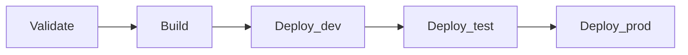

# CI/CD pipeline

`pipelines/orders-api.yml` is an Azure DevOps pipeline that deploys one app together with its
configuration set, environment by environment. The steps live in reusable templates under
`pipelines/templates/`, so a second app needs only its own short pipeline file.



## Stages

| Stage | Runs on | What it does | What it checks |
| --- | --- | --- | --- |
| Validate | every run, pull requests included | Pester tests, `Test-AppConfiguration.ps1`, `New-PipelineVariables.ps1 -Check` | the scripts behave; every app is valid for every environment; the generated pipeline variables are up to date |
| Build | not on pull requests | resolves the configuration per environment into an artifact, publishes the scripts, builds the application | every token has a value in that environment |
| `Deploy_<environment>` | not on pull requests, after approval | imports, deploys, swaps, smoke tests; rolls back on failure | see below |

Validate needs no Azure access and no secrets, which is what makes it safe for pull requests.

## The build number is the label

```yaml
name: $(Date:yyyyMMdd)$(Rev:.r)
```

The [run number](https://learn.microsoft.com/azure/devops/pipelines/process/run-number) becomes,
for example, `20260301.2`, and the deploy template uses `$(Build.BuildNumber)` as the label of the
configuration set. `$(Rev:.r)` makes it unique within the pipeline, so every run gets its own set.
Use one pipeline per app: two pipelines that deploy the same app could produce the same label.

Rerunning a failed stage keeps the build number, and with it the label. That is safe: the import
writes nothing for a set that is already complete, and activating does nothing when production
already carries the label.

## Artifacts

The Build stage publishes:

| Artifact | Contents |
| --- | --- |
| `appconfig-<environment>` | `<app>/` with the resolved files, one artifact per environment |
| `appconfig-scripts` | the `app-configuration` folder: scripts, library and schemas |
| `app` | the application package |

A [deployment job](https://learn.microsoft.com/azure/devops/pipelines/process/deployment-jobs)
does not check out the repository. The deploy stages therefore run the scripts from the
`appconfig-scripts` artifact: the same version of the scripts that validated and built the
configuration.

## The deploy stage

Each environment gets a stage with one deployment job, from `templates/deploy-environment.yml`. It
uses the `runOnce` strategy. Each lifecycle hook runs as a separate job, in this order:

| Hook | Template | Steps | Fails when |
| --- | --- | --- | --- |
| `deploy` | `import-configuration.yml` | import the set under the label | a file still contains a token or is invalid; the store refuses a write |
| | `activate-configuration.yml` (`include: point`) | point staging at the label, before the code arrives | the set has no sentinel |
| | | start the staging slot, deploy the package to it ([Azure Web App task](https://learn.microsoft.com/azure/devops/pipelines/tasks/reference/azure-web-app-v1)); the new code starts with its own set | the deployment fails |
| `routeTraffic` | `activate-configuration.yml` (`include: swap`) | swap staging into production | the swap or its warm-up fails; production does not carry the label afterwards |
| `postRouteTraffic` | (inline) | request `https://<default host name>/health` on production, up to 10 times, 15 seconds apart | production does not answer with a success status |
| `on: failure` | `rollback-configuration.yml` | start staging, swap back, stop staging | there is no previous set to return to |
| `on: success` | `cleanup-configuration.yml` | delete sets that neither slot uses, stop staging | neither slot carries this deployment's label |

Only the `deploy` hook downloads artifacts automatically. The template lists exactly the three it
needs; every later hook downloads `appconfig-scripts` itself, and the smoke test downloads nothing.

The smoke test calls the default host name from the build agent. When production sits behind
authentication, access restrictions or a private endpoint, that call fails: allow the health path
from the agent, run the pipeline on an agent inside the network, or replace the step with your own
check.

The scripts run in the [Azure CLI task](https://learn.microsoft.com/azure/devops/pipelines/tasks/reference/azure-cli-v2)
with `scriptType: pscore`, signed in as the service connection. The details of activate, rollback
and cleanup are in [Deployment and rollback](deployment-and-rollback.md).

Parameters of the template:

| Parameter | Default | Meaning |
| --- | --- | --- |
| `appName` | | the folder name under `app-configuration/apps/` |
| `environment` | | an object with `name`, `serviceConnection`, `storeName`, `resourceGroup`, `webAppName` |
| `healthCheckPath` | `/health` | used for the swap warm-up and the smoke test |
| `appType` | `webAppLinux` | `webApp` for a Windows web app |
| `stopStagingWhenDone` | `true` | stop the staging slot after the deployment, so the previous version does not keep running (and processing messages) next to production |

The pipeline builds the `environment` object per stage. `name` and `serviceConnection` come from
its `environments` parameter, because Azure DevOps needs them while it compiles the pipeline. The
store, resource group and web app are `$(AppConfigurationStoreName)`, `$(ResourceGroupName)` and
`$(WebAppName)`, from the generated variable template the stage loads
(`pipelines/variables/orders-api/<environment>.yml`). See
[Generated pipeline variables](generated-pipeline-variables.md).

## Environments and approvals

Every deployment job targets an Azure DevOps
[environment](https://learn.microsoft.com/azure/devops/pipelines/process/environments) named
`<app>-<environment>`, such as `orders-api-prod`. Azure Pipelines can create an environment
automatically the first time a pipeline refers to it, but then it has no checks. Create them up
front instead and add an
[approval check](https://learn.microsoft.com/azure/devops/pipelines/process/approvals) to every
environment that needs one: the stage does not start until an approver approves. Checks are
managed in the web interface, not in the YAML, so someone who edits the pipeline cannot remove
them. The environment also records which run was deployed where.

Environment names become stage names (`Deploy_<environment>`), so use letters, digits and
underscores only.

## Service connection: workload identity federation

Each environment names an Azure Resource Manager service connection. Use
[workload identity federation](https://learn.microsoft.com/azure/devops/pipelines/library/connect-to-azure):
the pipeline gets a short-lived token for the identity behind the connection, and there is no
client secret to store, rotate or leak.

Use a separate connection, and a separate identity, per environment, so a pipeline run for dev
cannot touch prod. Give each identity only:

- **App Configuration Data Owner** on the store of its environment
- **Website Contributor** on the web app of its environment

See [Permissions](permissions.md). The identity needs no Key Vault access: the pipeline writes
references to secrets, never the secrets themselves.

Checks can be set on a service connection as well. A *Branch control* check on the production
connection, allowing only `refs/heads/main`, keeps runs from other branches away from it.

## Pull requests

The pipeline triggers on `main` for changes under `app-configuration/` and `pipelines/`. To
validate pull requests, add it as
[build validation](https://learn.microsoft.com/azure/devops/repos/git/branch-policies) in the branch
policy of `main`, with a path filter such as `/app-configuration/*`. A pull request run stops
after Validate; the Build and Deploy stages have the condition
`ne(variables['Build.Reason'], 'PullRequest')`.

Add your application's source folder to the trigger paths (`src/*` is commented out in the
example).

## Before the commit: a pre-commit hook

The pipeline catches every mistake, but only after a push. `.githooks/pre-commit` runs the
validator when a staged change touches `app-configuration/apps/`, `variables/`, `schemas/` or
`lib/`, and blocks the commit when it fails. Then it regenerates the pipeline variables of the
pipelines the staged change affects, and stops the commit when a generated file changed, so you
can review and stage it (see [Before the commit](generated-pipeline-variables.md#before-the-commit)).
Enable it once per clone:

```console
git config core.hooksPath .githooks
```

`git commit --no-verify` skips it. Keep a hook like this fast and limited to what changed: a hook
that takes long, or runs on every commit, gets skipped. It is a convenience, not a gate; the
Validate stage stays the gate. `.gitattributes` keeps the hook's line endings LF, because `sh`
fails on CRLF.

## Validating only what changed

The validator checks every app against every environment, which takes seconds for a handful of
apps. With many apps, a pull request can validate only what it touches:

| Changed | Validate |
| --- | --- |
| `apps/<app>/` | `./Test-AppConfiguration.ps1 -AppName <app>` |
| `variables/<environment>.json` | `./Test-AppConfiguration.ps1 -Environment <environment>` |
| `variables/common.json`, `schemas/`, `lib/` | everything |

Validate everything on `main` regardless, so a gap in this mapping cannot hide a broken app for
long.

## PowerShell version

The scripts need PowerShell 7.2 or later (`#Requires -Version 7.2`). The Azure CLI task runs them
with `scriptType: pscore`, which is PowerShell 7 on every hosted agent. Windows PowerShell 5.1 does
not work: the scripts use `System.Text.Json` and the ternary operator. On a self-hosted agent,
install PowerShell 7 first.

## A second app

Copy `pipelines/orders-api.yml`, change `appName`, `appProject`, the trigger paths, the
environment list and the path of the variables template. Add `pipelines/<pipeline>.variables.json`
when the pipeline needs its own values (a different web app name, say), run
`./app-configuration/New-PipelineVariables.ps1` and commit the generated files. The templates stay
as they are.

## GitHub Actions

The workflow in `.github/workflows/ci.yml` is the CI of this repository: tests on Ubuntu and
Windows, the validator, the drift check of the generated pipeline variables, a leak check and a
link check. It does not deploy. The scripts do not
depend on Azure DevOps; to deploy from GitHub Actions, sign in with `azure/login` using
OpenID Connect and run the same scripts in the same order.
