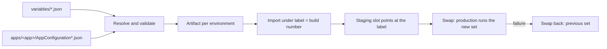

# How it works

From a variable in a JSON file to a configuration set that a running app reads, in six steps.



## 1. Four files per app, with tokens

Every app has a folder under `app-configuration/apps/` with four files, and an optional fifth:

| File | Becomes in the store |
| --- | --- |
| `AppConfiguration.json` | settings, key `<app>:<path>`, label = the deployment |
| `AppConfiguration.KeyVault.json` | Key Vault references, key `<app>:<path>`, label = the deployment |
| `AppConfiguration.FeatureFlags.json` | feature flags `<app>.<Name>`, label `feature-flag` |
| `AppConfiguration.CircuitBreakerFlags.json` | feature flags `<app>.<Name>`, label `circuit-breaker` |
| `AppConfiguration.ApplicationParameters.json` (optional) | parameters `<app>:Parameters:<Name>`, label `app-parameter` |

A value that differs per environment is a token, `#{VariableName}#`, filled from
`app-configuration/variables/`. See [The four files](the-four-files.md),
[Variables and environments](variables-and-environments.md) and
[Application parameters](application-parameters.md).

## 2. Resolve and validate, offline

`Test-AppConfiguration.ps1` resolves every app against every environment and checks the result:
JSON syntax and duplicate keys, the schemas, tokens that are unknown or unterminated, Key Vault
URIs, flag names and filters, parameter data types and start dates, keys that collide once the
files are flattened, and values that belong to another environment. It needs no Azure access, so
it runs on every pull request, and as a pre-commit hook if you like.

## 3. One artifact per environment

`Build-AppConfiguration.ps1` writes the files of one app for one environment, every token
replaced. The pipeline does this once per environment in its Build stage and publishes each result
as an artifact (`appconfig-dev`, `appconfig-test`, ...). Later stages deploy that artifact; they do
not resolve again. What was validated is what gets deployed.

## 4. Import under a label that identifies the deployment

`Import-AppConfiguration.ps1` writes the artifact to the store. Every setting and Key Vault
reference gets the deployment label, which in the pipeline is the build number, for example
`20260301.1`. Each deployment therefore adds a *complete* new set next to the ones already there:

```text
orders-api:Orders:PageSize        20260301.1   50
orders-api:Orders:PageSize        20260302.1   25
orders-api:Payments:ApiKey        20260302.1   {"uri":"https://kv-orders-dev.vault.azure.net/secrets/payments-api-key"}
orders-api:Sentinel               20260302.1   3f1c...
```

The import compares first and writes only what differs; a second run with the same label writes
nothing. The last key it writes is `<app>:Sentinel`, a hash of the whole set. Its presence means the
set is complete, and every later step refuses a label without one.

Flags are different: they live under a fixed label, are shared by every set, and keep the
enabled state they have in the store. See [The four files](the-four-files.md#feature-flags).
Application parameters too: one fixed label, values kept from the store.

## 5. The staging slot points at the new set

The app learns which set to read from one app setting, `AppConfiguration__Label`
(`AppConfiguration:Label` in .NET configuration). `Set-SlotConfigurationLabel.ps1` sets it on the
staging slot right after the import, before the new version of the app is deployed there. The new
version therefore starts with the new set. See [Reading configuration in your app](reading-configuration-in-your-app.md).

## 6. The swap makes it live; a swap back undoes it

`Switch-ConfigurationSet.ps1` swaps staging into production. The label setting is not a
deployment slot setting, so it moves with the swap: production now runs the new application *and*
the new set, and staging holds the previous application with the previous label.

That is the rollback. If anything fails after the swap, `Undo-ConfigurationSet.ps1` swaps back,
and production returns to the previous application and the previous set together, every setting
at once. After a successful deployment `Remove-ObsoleteConfigurationSets.ps1` deletes the sets that
neither slot points at. See [Deployment and rollback](deployment-and-rollback.md).

## Where the code is

| Script | Step |
| --- | --- |
| `app-configuration/Test-AppConfiguration.ps1` | 2 |
| `app-configuration/Build-AppConfiguration.ps1` | 3 |
| `app-configuration/Import-AppConfiguration.ps1` | 4 |
| `app-configuration/Set-SlotConfigurationLabel.ps1` | 5 |
| `app-configuration/Switch-ConfigurationSet.ps1` | 6 |
| `app-configuration/Undo-ConfigurationSet.ps1` | 6, on failure |
| `app-configuration/Remove-ObsoleteConfigurationSets.ps1` | 6, on success |
| `app-configuration/Set-ApplicationParameter.ps1` | any time: plan a parameter value |

All of them load `app-configuration/lib/AppConfiguration.ps1`, and every call to Azure goes through
one function in it, `Invoke-AzCli`. The tests replace that function with an in-memory store and web
app. Every script that changes something supports `-WhatIf`.
